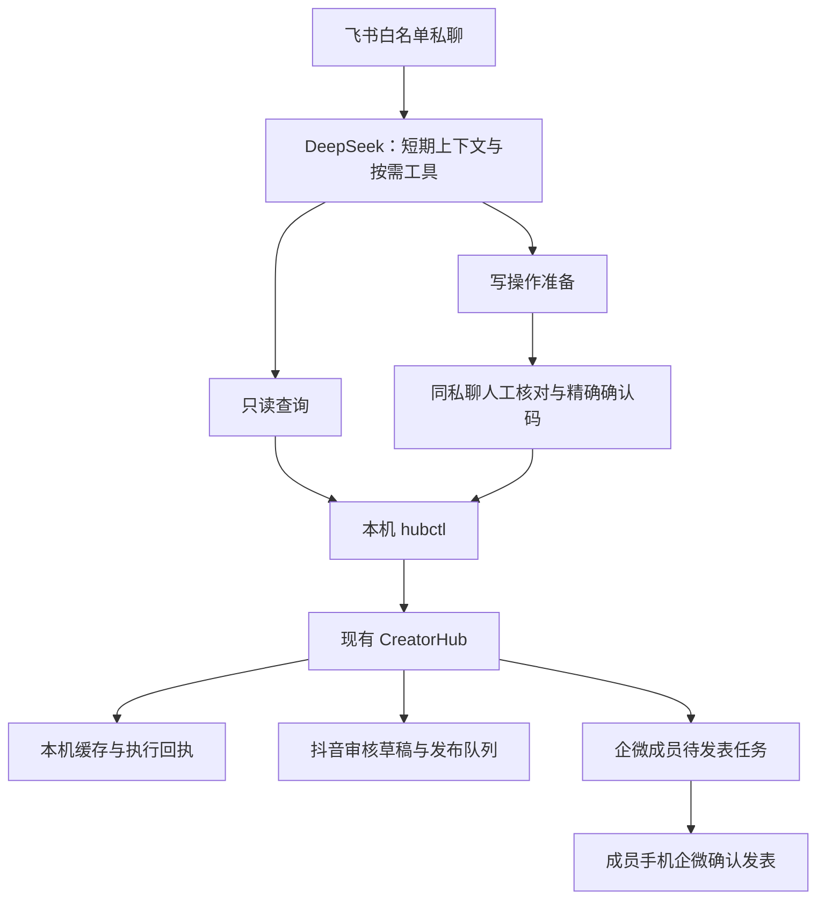

# Huilima：在原 Hub 中接入企微、CLI 与飞书 AI

本功能复用 CreatorHub 的本机界面、账号、数据库与任务队列，不新建另一套业务中控台。默认关闭真实外发、自动刷新和业务云备份，需由本机管理员明确配置与逐项验收。



## 已接入的技术能力

- 企微应用只读鉴权与成员/客户 ID 列表核对；客户、客户群、群发执行及客户朋友圈记录的摘要快照。只读查询不读取普通群聊天正文，不使用客户端 Hook 或会话存档。
- 客户朋友圈：本地草稿、显式企业客户标签范围、执行成员绑定、不可变媒体清单、人工审核指纹、单次任务创建，以及明确确认后的一次官方状态刷新。不会把“创建任务”“成员发表”“客户可见/已读”混为一谈。
- 已登记素材、发布草稿审核、低频同步、离线意向候选、CRM 字段预检与持久投递回执，以及本地/可选飞书云盘视频备份和隔离恢复。
- CLI JSON/JSONL 客户端，以及飞书私聊 AI 的 46 个固定工具。默认 JSONL 接口仍禁止外发、批准和完整人工审核快照直通模型；飞书的受控确认器经逐单确认后才调用相关本机 CLI 命令。

## 目录与入口

| 目录 | 用途 |
|---|---|
| `huilima_plugin/wecom_*.py`、`huilima_plugin/web/` | 插件企微与扩展页面，app 旧路径保留兼容入口 |
| `huilima_plugin/business_*.py`、`huilima_plugin/operations_*.py` | 复用 Hub 的业务状态与工作流 |
| `clients/creatorhub-cli/` | CLI 0.12 与默认受限 JSONL 入口 |
| `integrations/feishu-bot/` | 白名单私聊、模型、工具路由和确认器 |
| `tests/test_wecom_*.py` | 合成/隔离企微与朋友圈测试 |

Hub 按原仓库说明启动。CLI 和机器人按各自目录的 README 配置；个人密钥、Cookie、账号、数据库、日志及备份不属于源码交付内容。

## 企微配置边界

应用管理员应使用自己的企业与应用授权，按腾讯后台实际要求完成可见成员、客户联系可调用应用、可信 IP 及必要的域名归属验证。真实凭据仅保存本机权限受限文件。代码不自动新增权限、可信 IP 或域名，也不向服务器复制凭据。

先运行只读预检，再选择一个由所有者控制且同意测试的成员/客户标签范围。草稿需明确内容、素材和目标范围；审核和派发分别有稳定编号及回执。提交超时/中断不等于失败，先核对原任务，不重新编号或自动重投。成员还需在手机企微确认发表。

## 测试与验收范围

本地开发版本已完成企微测试客户核对、单条纯文字朋友圈成员发表、飞书私聊真实工具查询与确认后官方只读刷新；发布批准和企微派发确认器也经过隔离环境验证。上述结果不代表新部署自动拥有企业权限，不代表客户看到/已读，也不代表所有素材类型与长期运行已完成验收。

员工手机“领材料→转发→回传→审核”的完整验收，以及普通群聊天正文采集，不属于本次交付验收范围。业务备份的目的地、CRM 正式表、真实平台发布及生产启用，应由部署者逐项确认。

```sh
# 使用已安装根目录 requirements 的隔离 Python 环境
python -m pytest -q tests/test_wecom_readonly.py tests/test_wecom_customer_readonly.py tests/test_wecom_workflows.py tests/test_wecom_moments.py
(cd clients/creatorhub-cli && python -m unittest discover -s tests -q)
(cd integrations/feishu-bot && python -m unittest discover -q)
```

测试数据均为合成数据；CI 不应配置真实平台密钥或发布素材。源码上传不代表部署升级，不会自动修改运行中的 Hub、V100 或飞书应用配置。


## 插件拆分进度

独立包 0.1.0 第一阶段：实现模块、页面片段、资源与注册/生命周期已移出宿主；仍保留模型、发布、调度等必要安全适配，不是上游零改动插件。详见 [插件边界与后续收敛](../huilima_plugin/README.md)。现有 main 同步任务与运行中服务未改变。
